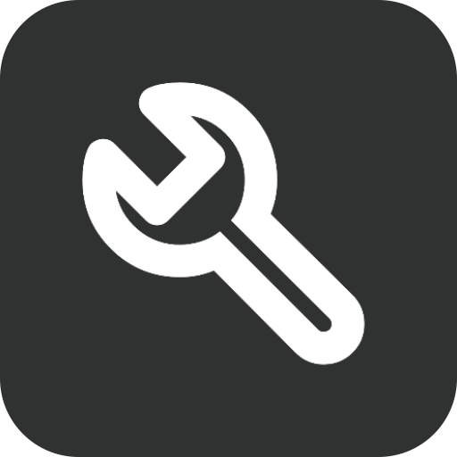
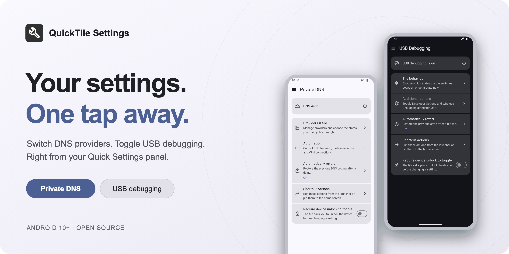
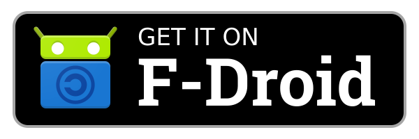
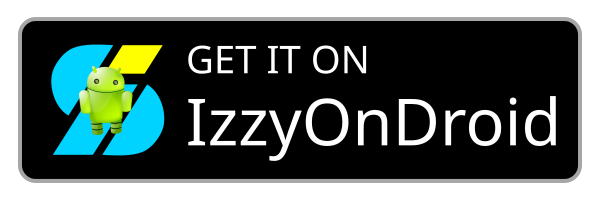
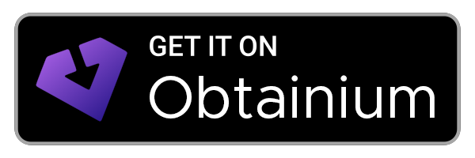
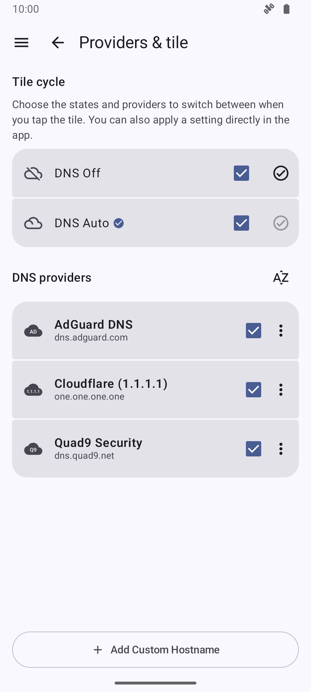
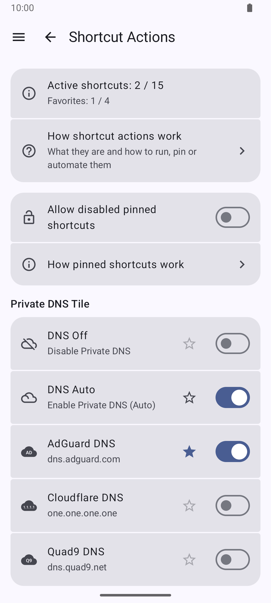
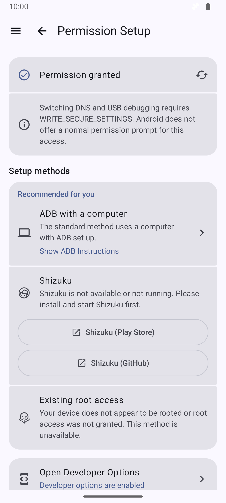

<div align="center">
  
  <h1>QuickTile Settings</h1>
  <p>Private DNS and USB debugging, one tile away.</p>
  <p>Choose your DNS provider, switch settings for each network, and keep your most-used actions close.</p>

  <a href="https://github.com/RBN-Apps/Quick-Tile-Settings/releases/latest"></a>
  
  <a href="LICENSE"></a>

</div>

<p align="center">
  <picture>
    <source media="(prefers-color-scheme: dark)" srcset="docs/assets/readme-banner.png" />
    <source media="(prefers-color-scheme: light)" srcset="docs/assets/readme-banner-light.png" />
    
  </picture>
</p>

<p align="center">
  <a href="https://f-droid.org/packages/com.rbn.qtsettings/"></a>
  <a href="https://apt.izzysoft.de/fdroid/index/apk/com.rbn.qtsettings/"></a>
</p>
<p align="center">
  <a href="https://github.com/RBN-Apps/Quick-Tile-Settings/releases/latest"></a>
  <a href="https://apps.obtainium.imranr.dev/redirect?r=obtainium%3A%2F%2Fapp%2F%257B%2522id%2522%253A%2522com.rbn.qtsettings%2522%252C%2522url%2522%253A%2522https%253A%252F%252Fgithub.com%252FRBN-Apps%252FQuick-Tile-Settings%2522%252C%2522author%2522%253A%2522RBN-Apps%2522%252C%2522name%2522%253A%2522QuickTile%2520Settings%2522%257D"></a>
</p>

## Make the tiles yours

QuickTile Settings adds two tiles to Android's Quick Settings panel. Tap to move through the states you choose. Open the app to manage providers, set up automation or change a setting directly.

| Private DNS | USB debugging |
| --- | --- |
| Switch between Off, Auto and your chosen providers. | Turn USB debugging on or off from its tile. |
| Start with AdGuard, Cloudflare or Quad9, or add a custom hostname. | Optionally toggle Developer Options and Wireless Debugging at the same time. |
| Choose and sort the providers included in the tile cycle. | Choose which states the tile cycles through. |
| Restore the previous DNS setting after a delay. | Restore the previous debugging setting after a delay. |

Both tiles can require device unlock before changing a setting.

## Let DNS follow your network

Choose separate DNS targets for Wi-Fi and mobile data. Add rules for individual Wi-Fi networks using their name (SSID), with an optional BSSID to match a specific access point. Networks without a matching rule use your Wi-Fi default. Search helps you find a network or DNS target in longer lists.

You can also turn Private DNS off while a VPN is connected and restore it after disconnection. Detection can run while the tile is visible or in the background. Per-network Wi-Fi rules require background detection and the location access described in the app.

## Keep your actions within reach

Enable shortcut actions for your launcher and compatible automation apps, or pin them to your home screen. DNS and USB share the available shortcut slots and four favorites. The app shows the action limit reported by your device.

The navigation menu takes you to either tile, Shortcut Actions, Settings, permission setup and About. Light and dark themes follow your system, with dynamic colors on Android 12 and later.

<p align="center">
  <picture>
    <source media="(prefers-color-scheme: dark)" srcset="docs/assets/gallery/providers-dark.png" />
    <source media="(prefers-color-scheme: light)" srcset="fastlane/metadata/android/en-US/images/phoneScreenshots/2.png" />
    
  </picture>
  <picture>
    <source media="(prefers-color-scheme: dark)" srcset="fastlane/metadata/android/en-US/images/phoneScreenshots/5.png" />
    <source media="(prefers-color-scheme: light)" srcset="docs/assets/gallery/shortcuts-light.png" />
    
  </picture>
  <picture>
    <source media="(prefers-color-scheme: dark)" srcset="fastlane/metadata/android/en-US/images/phoneScreenshots/6.png" />
    <source media="(prefers-color-scheme: light)" srcset="docs/assets/gallery/permission-light.png" />
    
  </picture>
</p>

More screenshots: [English](fastlane/metadata/android/en-US/images/phoneScreenshots) · [Deutsch](fastlane/metadata/android/de-DE/images/phoneScreenshots).

## Get started

You need Android 10 or later. Changing Private DNS and USB debugging requires `WRITE_SECURE_SETTINGS`, a protected Android permission. The welcome flow explains the features and walks you through setup. You can return to **Permission setup** from the navigation menu at any time.

1. Install the app from one of the download links above.
2. Grant the permission using ADB, a running Shizuku installation or existing root access.
3. Open your Quick Settings panel, edit its tiles, and add **Private DNS** and **USB Debugging**.
4. Choose your providers and tile behavior in the app.

### ADB setup

Enable Developer Options and USB debugging in Android settings, connect your phone to a computer with ADB installed, and approve the computer on your phone. Run:

```sh
adb shell pm grant com.rbn.qtsettings android.permission.WRITE_SECURE_SETTINGS
```

The in-app ADB guide includes the individual steps and a copy button. Root is not required for this method. If you use [Shizuku](https://shizuku.rikka.app/) or already have root access, choose that method on the permission setup page and follow its prompts.

### Background detection and permissions

Background detection uses a foreground service. On Android 13 and later, notification permission is optional: detection still works without it, and Android lists the service in its active apps area. Earlier Android versions require the ongoing service notification.

Wi-Fi network identification needs location access and enabled location services. The app explains the additional access needed for background Wi-Fi rules. These permissions are separate from the permission used to change system settings.

## Back up your setup

Open **Settings → Backup & restore** to export tile preferences, DNS entries, automation rules and shortcut configuration to a JSON file. Restore a current or supported older backup on another installation.

Restoring replaces the app's current configuration. System permissions are not part of the backup and must be granted separately on each device. Keep a copy before experimenting with your settings.

## Help and contributions

Found a bug? Open **About → Report an issue** in the app to prepare a GitHub report. You can optionally include technical information and review it before submitting. About also has a feature request link.

You can [report bugs or suggest features on GitHub](https://github.com/RBN-Apps/Quick-Tile-Settings/issues). Contributions to code, translations and documentation are welcome.

### Build from source

Clone the project and open it in Android Studio. Let Gradle sync, then run the `app` configuration on a device or emulator. From a configured Android development environment:

```sh
git clone https://github.com/RBN-Apps/Quick-Tile-Settings.git
cd Quick-Tile-Settings
./gradlew assembleDebug
```

The debug APK is written to `app/build/outputs/apk/debug/`. The app uses Kotlin, Jetpack Compose and Navigation 3.

## Star history

<a href="https://www.star-history.com/?repos=RBN-Apps%2FQuick-Tile-Settings&type=date&legend=top-left">
 <picture>
   <source media="(prefers-color-scheme: dark)" srcset="https://api.star-history.com/image?repos=RBN-Apps/Quick-Tile-Settings&type=date&theme=dark&legend=top-left" />
   <source media="(prefers-color-scheme: light)" srcset="https://api.star-history.com/image?repos=RBN-Apps/Quick-Tile-Settings&type=date&legend=top-left" />
   
 </picture>
</a>
